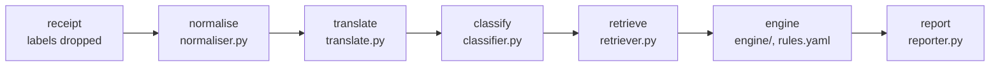

# Expense Policy Validator

A language model says what each receipt line is; plain code checks it against the nine policies and quotes the policy for every exception. Results: [`outputs/results.jsonl`](outputs/results.jsonl). More: [evaluation](docs/evaluation.md), [AWS design](docs/aws-design.md), [decisions](DECISIONS.md), [working log](NOTES.md). **Setup:** with Python 3.12 and [uv](https://docs.astral.sh/uv/), copy the organisers' `data/` into the repo and run `uv sync`. `make test`, `make run`, `make eval`, `make baseline` and `make app` (the viewer) run offline from the committed model cache. New model calls need `OPENROUTER_API_KEY` in a `.env` (see `.env.example`).

## Architecture

Each component is its own module in [`validator/`](validator); only translation and classification call the model, and every call is cached.

**End to end, RCP-011:** Cellar Door Fine Wines (MCC 5921), Client Entertainment, pre-approval PA-2026-0431: "Vino tinto Rioja Reserva 750ml" is glossed "Rioja Reserva red wine 750ml" and classified `alcohol` (restricted) at 0.99996. Of 12 retrieved rules, the engine raises ALC-03 on L1 (alcohol bought where it isn't served) and MCC-01 (high-risk merchant), which the pre-approval doesn't waive: **flag**, as in the answer key. Each step is in [`outputs/traces.jsonl`](outputs/traces.jsonl).

## Prompts

The classification prompt ([classifier.py](validator/classifier.py)) defines the 21 categories in its own words and says to classify what an item is, not the words in its name, with the merchant as context only. `category` comes before `reason`, so the confidence (the category tokens' probability) measures the answer, not a justification. The translation prompt asks for a literal gloss. Both were tuned only on a 43-item hand-written dev set, by an assistant that had the answer key.

## Policy engine

[`rules/rules.yaml`](rules/rules.yaml) holds 40 rules, each with a severity, parameters, `applies_to` and a policy quote a test checks word for word; the 34 that can fire each have a small Python check (`Decimal` money, inclusive caps). On the answer key's categories the engine matched all 28 in-scope receipts (the assistant that wrote it had the key to hand), and switching off any one check fails a test ([`test_check_coverage.py`](tests/test_check_coverage.py)). **Confidence threshold: 0.5,** pre-registered and held on the dev set (its one miss scored 0.43): a line below it raises EXC-03 and is left out of every other rule.

## Evaluation summary

The labelled receipts are the only test set, so the frozen config's first run was committed before scoring; the submitted OpenRouter run changed no category or decision. The 28 in-scope receipts, with 95% Wilson intervals:

| | System | Keyword baseline |
|---|---|---|
| Item macro F1 / restricted F1 | 1.000 / 1.000 | 0.738 / 0.791 |
| Receipts exactly right | 28 / 28 (88–100%) | 20 / 28 |
| False positives · missed violations | 0 / 9 (0–30%) · 0 / 16 (0–19%) | 2 / 9 · 2 / 16 |

This proves less than it looks: the traps are the taxonomy's own examples, the assistant that wrote the prompt had seen these receipts, and with nine clean receipts a 30% false-positive rate fits the interval. On 100 real Indonesian receipts ([CORD](cord/README.md)), against the assistant's labels (57 hand-checked), it got 93% of lines right but flagged or reviewed 13 of 98 clean ones (with one restricted line and one made-up context, it tests the classifier more than the rules).

## AI collaboration

Claude Code (Claude Opus 5.5) wrote most of the code, tests and docs; I made the calls and checked the results, and my questions (how real tools do it, which stage to blame, what we test on, does it hold on real receipts) each changed what got built. [NOTES.md](NOTES.md) logs where I directed, overrode or corrected it. **What it got wrong:** at temperature 0 every chosen token's logprob was 0.0, so the smoke test passed on meaningless numbers until the assistant read the raw values. **Checked by hand:** the 11 translations and 57 CORD labels. **Who saw the data:** Anthropic, through the assistant, saw the brief, policies, receipts and answer key. The model APIs (OpenRouter via Fireworks for the submitted run) saw only line text, merchant, MCC description and expense type, plus the public CORD lines; no amounts, employee fields or labels.

## Spend

**$0.0540 over 359 calls** through OpenRouter (`outputs/spend.jsonl`), as billed; a full run costs $0.0062, and the first run's 350 calls ($0.0759 at peak prices) are in git history. **Model:** DeepSeek V4.1 Flash (`deepseek/deepseek-v4.1-flash`, 1017 release), which I pushed for: with reasoning off it led the open-weights models on Artificial Analysis's Intelligence Index in September 2026 ([archived](https://web.archive.org/web/20260925000203/https://artificialanalysis.ai/models/deepseek-v4-1-flash-non-reasoning)), uses few tokens (152 a receipt) and returns the logprobs the confidence needs. Reasoning stays off: nothing in the data needs it, and it would use 3.4 times the output tokens ([why](DECISIONS.md#8-model)). Calls are pinned to Fireworks, then Together, the hosts checked to return logprobs; Fireworks served every call.

## What I would do next

Measure flag precision and calibrate the threshold on the company's own receipts; send names to the model only as placeholders; gloss dish names as the dish, not word by word ("TALAM UNGU" became "PURPLE TRAY").
