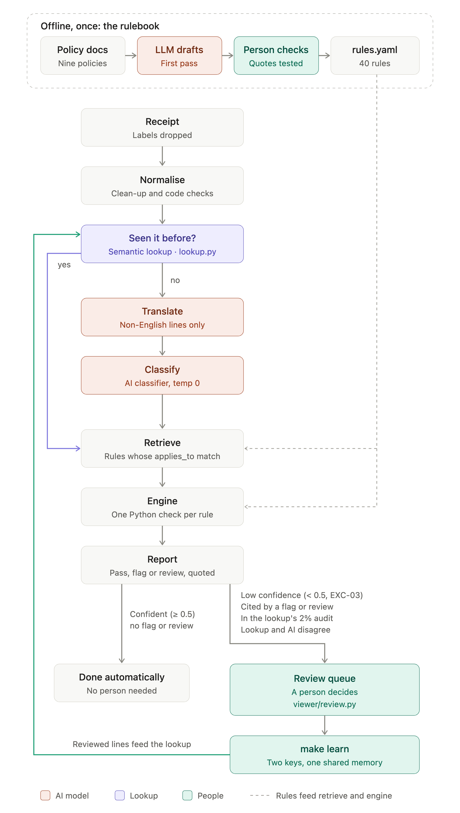

# Expense Policy Validator

A language model says what each receipt line is; plain code checks it against the nine policies and quotes the policy for every exception. Results: [`outputs/results.jsonl`](outputs/results.jsonl). More: [evaluation](docs/evaluation.md), [AWS design](docs/aws-design.md), [decisions](DECISIONS.md), [working log](NOTES.md).

**Run it locally** (Python 3.12, [uv](https://docs.astral.sh/uv/) and `make`; no API key needed, as every model call is cached):
1. Clone this repo, copy the organisers' `data/` folder to its root, and run `uv sync`.
2. `make test`, `make run`, `make eval` and `make baseline` reproduce the committed outputs.
3. `make app` opens the viewer at http://localhost:8501.
4. Only new model calls need `OPENROUTER_API_KEY` in `.env` (see `.env.example`).

## Architecture

As in Expensify, Navan, SAP Concur and Ramp, **the model reads and code judges.** Of three designs, an LLM judging each receipt was rejected (untestable, and the brief bars it from EXC-01); keywords alone became the baseline (20 / 28); this split was picked (28 / 28). Each step is a module in [`validator/`](validator); only translation and classification call the model. The semantic lookup ([`lookup.py`](validator/lookup.py)) reuses a reviewed answer only when every word matches it by meaning and nothing restricted is close; reviews fill it through `make learn` only when the model agrees. On these receipts it decides 1 line.

**End to end, RCP-011:** Cellar Door Fine Wines (MCC 5921), Client Entertainment, pre-approval PA-2026-0431. "Vino tinto Rioja Reserva 750ml" is glossed "Rioja Reserva red wine 750ml" and classified `alcohol` at 0.99996. Of 12 retrieved rules, the engine raises ALC-03 on L1 (alcohol bought where it isn't served) and MCC-01 (high-risk merchant), which the pre-approval doesn't waive: **flag**, as in the answer key. Every step: [`outputs/traces.jsonl`](outputs/traces.jsonl).

## Prompts

The classification prompt ([classifier.py](validator/classifier.py)) defines the 21 categories in its own words and says to classify what an item is, not the words in its name, with the merchant as context only. `category` comes before `reason`, so the confidence (the category tokens' probability) measures the answer, not a justification. The translation prompt asks for a literal gloss. Both were tuned only on a 43-item hand-written dev set.

## Policy engine

- **Rules as data, logic as code:** [`rules/rules.yaml`](rules/rules.yaml) holds 40 rules (severity, numbers, `applies_to`, the policy quote word for word, checked by a test); the 34 that can fire each have a small Python check.
- **A fixed order, no rule triggering another:** regional overrides, takeovers (GIFT-04 over GIFT-01, TIME-03 over a meal cap), each check, EXC-03, then EXC-01 for the disposition. Carve-outs need the right recorded reference; money is `Decimal`; caps are inclusive.
- **Tested:** [`tests/test_engine.py`](tests/test_engine.py) covers the brief's five cases (RCP-027, RCP-016, RCP-006/026, RCP-031, RCP-028). On the answer key's categories the engine matches all 28 receipts, and switching off any check fails a test.
- **Confidence threshold: 0.5,** fixed before any output was seen; a line below it raises EXC-03 and is left out of every other rule.

## Evaluation summary

The first run was committed before scoring. The 28 in-scope receipts, with 95% Wilson intervals:

| | System | Keyword baseline |
|---|---|---|
| Item macro F1 / restricted F1 | 1.000 / 1.000 | 0.738 / 0.791 |
| Receipts exactly right | 28 / 28 (88–100%) | 20 / 28 |
| False positives · missed violations | 0 / 9 (0–30%) · 0 / 16 (0–19%) | 2 / 9 · 2 / 16 |

This proves less than it looks: the traps are the taxonomy's own examples, the prompt's author had seen these receipts, and nine clean receipts can't rule out a 30% false-positive rate. The baseline does better only on cost, speed and keeping data in-house. None of the 28 is wrong, so the two failure cases come from outside the scored set: the split-receipt pair RCP-020/021 (rule logic, since fixed) and CORD-V008, where "TALAM UNGU" was glossed "PURPLE TRAY" (translation); see [evaluation](docs/evaluation.md).

**Two extra test sets I added (not part of the brief's data)** check that the result isn't tied to these 28 receipts:
- **Reworded** ([experiment 5](experiments/paraphrase/README.md)): every line of the 28 rewritten in other words and checked by hand before any run: 64 / 65 items, 27 / 28 receipts.
- **Real receipts** ([CORD](cord/README.md)): 100 public Indonesian receipts, with made-up context and my own labels (57 rechecked by hand): 94% of lines right, but 10 of 98 clean ones flagged or reviewed.

## AI collaboration

Claude Code (Claude Opus 5.5) wrote most of the code, tests and docs; I made the calls and checked the results, and [NOTES.md](NOTES.md) logs where I directed, overrode or corrected it. **What it got wrong:** on the first provider, at temperature 0 every chosen token's logprob was 0.0, so the smoke test passed on meaningless numbers until the assistant read the raw values. **Checked by hand:** the 11 translations and 57 CORD labels. **Who saw the data:** Anthropic, through the assistant, saw the brief, policies, receipts and answer key. The model services saw only line text, merchant, MCC description and expense type (no amounts, employee fields or labels), and in experiments 3 and 4 the policy text. They were DeepSeek's own API for the first run; OpenRouter (served by Fireworks, and DeepInfra for the experiments' embeddings) for the submitted run and the experiments; and, for experiment 2’s verifier on restricted lines only, Vercel AI Gateway and Baseten (Mammoth-1, used in place of Jev). The public CORD lines went to the same services.

## Spend

**About $0.45 over 2,949 calls on the OpenRouter key**, as billed: $0.0575 for the submitted run's 378 calls (`outputs/spend.jsonl`) and $0.39 for the experiments. The first run's 350 calls ($0.0759) went through DeepSeek's own API, before the key arrived. Experiment 2's verifier made 54 more calls through Vercel AI Gateway ($0.0011). **In all, the project spent $0.53 over 3,353 model calls**, not counting the coding assistant. **Model:** DeepSeek V4.1 Flash (`deepseek/deepseek-v4.1-flash`), which I pushed for: with reasoning off it led the open-weights models on Artificial Analysis's index ([archived](https://web.archive.org/web/20260925000203/https://artificialanalysis.ai/models/deepseek-v4-1-flash-non-reasoning)) and returns the logprobs the confidence needs ([why](DECISIONS.md#8-model)).

## What I would do next

Measure flag precision and calibrate both thresholds on the company's own receipts; say whether packaging sold with food is `other` (most CORD errors); send names to the model only as placeholders; gloss dish names as the dish.
