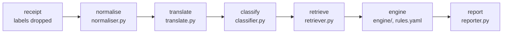

# Expense Policy Validator

A language model says what each receipt line is; plain code checks it against the nine policies and quotes the policy for every exception. Results: [`outputs/results.jsonl`](outputs/results.jsonl). More: [evaluation](docs/evaluation.md), [AWS design](docs/aws-design.md), [decisions](DECISIONS.md), [working log](NOTES.md). **Setup:** with Python 3.12 and [uv](https://docs.astral.sh/uv/), copy the organisers' `data/` into the repo and run `uv sync`. `make test`, `make run`, `make eval`, `make baseline` and `make app` (the viewer) run offline from the committed model cache. New model calls need `OPENROUTER_API_KEY` in a `.env` (see `.env.example`).

## Research first

Before writing any code, I spent [TIME] studying how real expense tools divide the work. [Expensify](https://help.expensify.com/articles/new-expensify/workspaces/Workspace-Rules), [Navan](https://navan.com/blog/audit-engine) and [SAP Concur](https://www.sap.com/products/spend-management/concur-expense-configuration-for-audit-rules.html) apply limits, category lists and merchant-code rules as configuration; even [Ramp's](https://support.ramp.com/policy-agent-overview) LLM-led Policy Agent layers fixed rules on top. The pattern: AI reads the receipt, rules decide. Of three designs:
- **An LLM judges each receipt:** rejected; caps and precedence done by a model can't be tested or repeated, and the brief bars it from deciding EXC-01.
- **Keywords and rules, no model:** free and repeatable, but misleading names beat it; kept as the baseline (20 / 28).
- **The model reads, code judges:** picked; the industry pattern, testable and traceable (28 / 28). Later choices and their alternatives: [DECISIONS.md](DECISIONS.md).

## Architecture

Each component is its own module in [`validator/`](validator); only translation and classification call the model, and every call is cached.

**End to end, RCP-011:** Cellar Door Fine Wines (MCC 5921), Client Entertainment, pre-approval PA-2026-0431: "Vino tinto Rioja Reserva 750ml" is glossed "Rioja Reserva red wine 750ml" and classified `alcohol` (restricted) at 0.99996. Of 12 retrieved rules, the engine raises ALC-03 on L1 (alcohol bought where it isn't served) and MCC-01 (high-risk merchant), which the pre-approval doesn't waive: **flag**, as in the answer key. Each step is in [`outputs/traces.jsonl`](outputs/traces.jsonl).

## Prompts

The classification prompt ([classifier.py](validator/classifier.py)) defines the 21 categories in its own words and says to classify what an item is, not the words in its name, with the merchant as context only. `category` comes before `reason`, so the confidence (the category tokens' probability) measures the answer, not a justification. The translation prompt asks for a literal gloss. Both were tuned only on a 43-item hand-written dev set, by an assistant that had the answer key.

## Policy engine

- **Rules as data, logic as code.** [`rules/rules.yaml`](rules/rules.yaml) holds 40 rules, each with a severity, parameters, `applies_to` and its policy quote; the 34 that can fire each have a small Python check. *Why:* a limit changes with a config edit, as in Expensify or Concur, while each rule's logic stays unit-tested; a rules library is overkill for 34 rules.
- **No rule triggers another, in a fixed order:** regional overrides, then each check, carve-outs, takeovers (TIME-03 over a meal cap, GIFT-04 over GIFT-01), EXC-03, and EXC-01 for the disposition. *Why:* chained rules are what make rule systems hard to debug, and a fixed order makes every outcome traceable.
- **Carve-outs need the right evidence.** Only a recorded reference of the kind a rule names waives it. *Why:* the brief says a missing reference means no carve-out.
- **`Decimal` money, inclusive caps.** *Why:* floating point can misjudge an amount at the cap, and a value at the cap is within it.
- **Quotes stored word for word,** and a test checks each against the policy. *Why:* evidence is graded, and a stored quote can't be invented.
- **Checked:** on the answer key's categories the engine matched all 28 in-scope receipts (the assistant that wrote it had the key to hand), and switching off any one check fails a test ([`test_check_coverage.py`](tests/test_check_coverage.py)).
- **Confidence threshold: 0.5,** pre-registered and held on the dev set (its one miss scored 0.43): a line below it raises EXC-03 and is left out of every other rule. *Why:* fixed before any output was seen, so it isn't tuned on the test set, and kept low because every EXC-03 signal is scored as wrong.

## Evaluation summary

The labelled receipts are the only test set, so the frozen config's first run was committed before scoring. The 28 in-scope receipts, with 95% Wilson intervals:

| | System | Keyword baseline |
|---|---|---|
| Item macro F1 / restricted F1 | 1.000 / 1.000 | 0.738 / 0.791 |
| Receipts exactly right | 28 / 28 (88–100%) | 20 / 28 |
| False positives · missed violations | 0 / 9 (0–30%) · 0 / 16 (0–19%) | 2 / 9 · 2 / 16 |

This proves less than it looks: the traps are the taxonomy's own examples, the assistant that wrote the prompt had seen these receipts, and with nine clean receipts a 30% false-positive rate fits the interval. On 100 real Indonesian receipts ([CORD](cord/README.md)), against the assistant's labels (57 hand-checked), it got 93% of lines right but flagged or reviewed 13 of 98 clean ones (with one restricted line and one made-up context, it tests the classifier more than the rules).

## AI collaboration

Claude Code (Claude Opus 5.5) wrote most of the code, tests and docs; I made the calls and checked the results. [NOTES.md](NOTES.md) logs where I directed, overrode or corrected it. **What it got wrong:** at temperature 0 every chosen token's logprob was 0.0, so the smoke test passed on meaningless numbers until the assistant read the raw values. **Checked by hand:** the 11 translations and 57 CORD labels. **Who saw the data:** Anthropic, through the assistant, saw the brief, policies, receipts and answer key. The model APIs (OpenRouter via Fireworks for the submitted run) saw only line text, merchant, MCC description and expense type, plus the public CORD lines; no amounts, employee fields or labels.

## Spend

**$0.0540 over 359 calls** through OpenRouter (`outputs/spend.jsonl`), as billed; a full run costs $0.0062, and the first run's 350 calls ($0.0759 at peak prices) are in git history. **Model:** DeepSeek V4.1 Flash (`deepseek/deepseek-v4.1-flash`, 1017 release), which I pushed for: with reasoning off it led the open-weights models on Artificial Analysis's index ([archived](https://web.archive.org/web/20260925000203/https://artificialanalysis.ai/models/deepseek-v4-1-flash-non-reasoning)), uses 152 output tokens a receipt and returns the logprobs the confidence needs; reasoning would cost 3.4 times the tokens for nothing this data needs ([why](DECISIONS.md#8-model)). Calls are pinned to Fireworks, then Together, the hosts that returned logprobs.

## What I would do next

Measure flag precision and calibrate the threshold on the company's own receipts; send names to the model only as placeholders; gloss dish names as the dish, not word by word ("TALAM UNGU" became "PURPLE TRAY").
