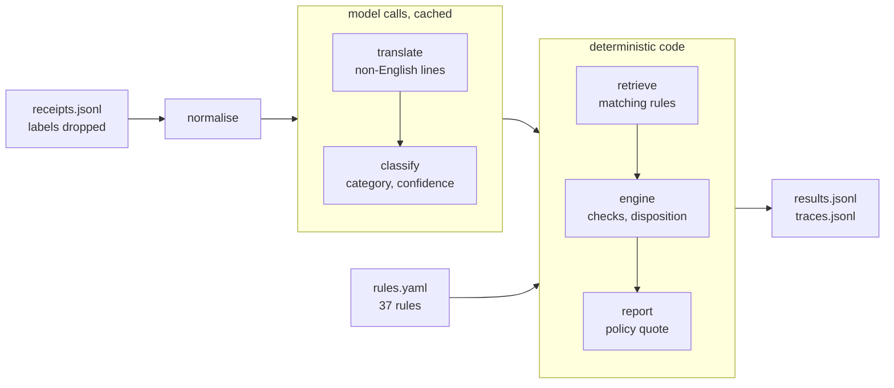

# Expense Policy Validator

A language model says what each receipt line is; plain code checks it against the nine policies and quotes the policy for every exception. Results: [`outputs/results.jsonl`](outputs/results.jsonl). See also the [evaluation](docs/evaluation.md), [AWS design](docs/aws-design.md), [decisions](DECISIONS.md) and [working log](NOTES.md).

**Setup.** With Python 3.12 and [uv](https://docs.astral.sh/uv/), copy the organisers' `data/` into the repo and run `uv sync`. `make test`, `make run`, `make eval`, `make baseline` and `make app` (the viewer) run offline from the model cache. New calls need a `.env` (see `.env.example`) with `LLM_PROVIDER` (`deepseek` or `openrouter`) and `DEEPSEEK_API_KEY` or `OPENROUTER_API_KEY`.

## Architecture

I first asked how real expense tools do this: Expensify, Navan, Concur and Ramp let AI read the receipt and keep limits as configuration, and so does this. All 32 receipts run together, because some caps add up spend across receipts.

## Prompts

The classification prompt ([classifier.py](validator/classifier.py)) defines the 21 categories in its own words and says to classify what an item is, not the words in its name, with the merchant as context only. `category` comes before `reason`, so the confidence (the probability of the category tokens) measures the answer, not a justification. The translation prompt asks for a literal gloss. Both were developed on a hand-written dev set of 43 items, never on the receipts.

## Policy engine

[`rules/rules.yaml`](rules/rules.yaml) holds 37 rules, each with a severity, parameters, `applies_to` and a policy quote that a test checks word for word. The 31 that can fire each have a small Python check, with `Decimal` money and inclusive caps; a rule that can't be applied is `not_evaluated`, not passed. Built first and tested on the answer key's categories, the engine matched all 28 in-scope receipts, though the assistant that wrote it had the key to hand. Switching off any one check fails a test ([`test_check_coverage.py`](tests/test_check_coverage.py)).

**Confidence threshold: 0.5.** A line below it raises EXC-03 and is left out of every other rule. Every dev item scored 0.96 or higher, so the pre-registered default stood.

## Evaluation summary

The 32 labelled receipts are also the only test set, so the frozen config's first run was committed before scoring. On the 28 in-scope receipts (95% Wilson intervals):

| | System | Keyword baseline |
|---|---|---|
| Item macro F1 / restricted F1 | 1.000 / 1.000 | 0.738 / 0.791 |
| Receipts exactly right | 28 / 28 (88–100%) | 20 / 28 |
| False positives · missed violations | 0 / 9 (0–30%) · 0 / 16 (0–19%) | 2 / 9 · 2 / 16 |

This proves less than it looks: the traps are the taxonomy's own examples, the assistant that wrote the prompt had seen these receipts, and with nine clean receipts a 30% false-positive rate fits the interval. On 100 real receipts from Indonesian shops ([CORD](cord/README.md)) it got 93% of lines right, and five of its six false flags were on lines the taxonomy can't clearly place.

## Walkthrough: RCP-011

Cellar Door Fine Wines (MCC 5921), Client Entertainment, pre-approval PA-2026-0431. "Vino tinto Rioja Reserva 750ml" is glossed "Rioja Reserva red wine 750ml" and classified `alcohol` (restricted) at 0.99999. Of 10 retrieved rules, the engine raises ALC-03 on L1 (alcohol bought where it isn't served) and MCC-01 (high-risk merchant). The pre-approval waives neither: **flag**, as in the answer key. [`outputs/traces.jsonl`](outputs/traces.jsonl) records each step.

## AI collaboration

Claude Code (Claude Opus 5.5) wrote most of the code, tests and docs; I made the calls and checked the results. My questions (how real tools do it, which stage to blame, what we test on, does it hold on real receipts) each changed what got built, and [NOTES.md](NOTES.md) logs where I directed, overrode or corrected the assistant, such as stopping it tuning the system on CORD. One thing it got wrong: at temperature 0 DeepSeek gives every chosen token a logprob of 0.0, so the smoke test passed on meaningless numbers until the assistant read the raw values. I signed off the 11 translations by hand. **Who saw the data:** Anthropic, through the assistant, saw the brief, policies, receipts and answer key. DeepSeek's API saw line text, merchant, MCC description and expense type (and the public CORD lines), never amounts, employee fields or labels. OpenRouter saw nothing.

## Spend

**$0.0759 over 350 calls** at peak prices (`outputs/spend.jsonl`); a full run costs $0.0081. I pushed for DeepSeek V4.1 Flash (`deepseek-flash`, 1017 release) since, with reasoning off, it was the top open-weights model on Artificial Analysis's Intelligence Index in September 2026 ([archived page](https://web.archive.org/web/20260925000203/https://artificialanalysis.ai/models/deepseek-v4-1-flash-non-reasoning)): it scores well on few tokens (156 output a receipt) and returns the logprobs behind the confidence. With only a DeepSeek key, the OpenRouter path has never run.

## What I would do next

- Build the TIME rules.
- Measure flag precision and calibrate the threshold on the company's own receipts.
- Rerun through OpenRouter, and send names to the model only as placeholders.
