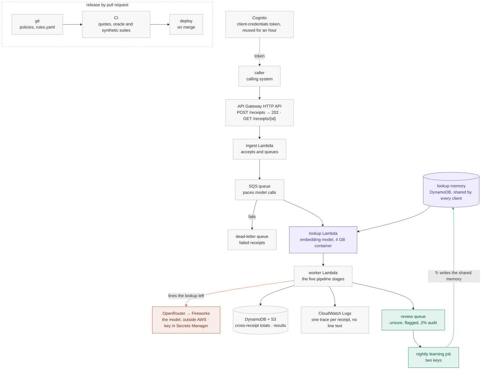

# Running the validator on AWS (on paper)

Coral: the model, outside AWS. Purple: the lookup. Teal: people. The [pipeline diagram](../README.md#architecture) shows what runs inside the lookup and worker Lambdas. As an image: [aws-deployment-clean.png](aws-deployment-clean.png) (or the Mermaid render, [aws-deployment.png](aws-deployment.png)).

**Architecture:** caller → API Gateway → ingest Lambda → SQS → lookup Lambda → worker Lambda (the five pipeline stages) → DynamoDB and S3.
- **API: API Gateway HTTP API** (cheaper than REST APIs, with a built-in JWT authorizer): `POST /receipts` returns `202` and an ID, `GET /receipts/{id}` the result.
- **Compute: ingest and worker Lambdas with SQS between them**, so callers never wait on the model; worker concurrency stays under the rate limit; failures go to the dead-letter queue.
- **Semantic lookup: its own Lambda** (a container image with the pinned open embedding model, 4 GB), so the worker isn't billed at 4 GB while it waits on the model. It decides a line only when every word matches, by meaning, a line a person reviewed, and passes the rest on; a receipt it decides whole never reaches the model.
  - **Memory: one DynamoDB table shared by every client** (keyed by word set), since what an item is doesn't depend on the company; what each company allows is in `rules.yaml`. So every client's reviews help every other, and a new client starts with what the others taught it. A line enters only when a person's decision and the model agree (two keys), never from the model alone; restricted lines, stored as item text without names, only ever block. It starts empty: until reviews arrive, every line goes to the model, as on main.
  - **Thresholds and the embedding model** are versioned files, released like `rules.yaml`.
  - **Reviews:** a review queue (the Review page's lines: unsure, flagged, audit sample, disagreements) feeds a nightly learning job under the two-key rule, writing the shared memory table. A correction from any client's reviewer removes a remembered line for everyone.
  - **Safeguards:** the model's answer is kept as a second opinion whenever it reads the receipt; 2% of the lookup's decisions go to an audit queue for a person; `mode: shadow` turns the lookup off if a check in the lookup report fails (DECISIONS.md, section 12).
- **State: DynamoDB** keeps cross-receipt totals (meal days, trip OTC, baggage, same-merchant days), written once per receipt ID so redeliveries aren't double-counted; a receipt that tips a day over a cap re-decides the earlier ones. Results go to S3.
- **Logs: CloudWatch Logs**, one trace per receipt, with no line text or names.

**Policy documents.** Policies and `rules/rules.yaml` live in git; a change is a reviewed pull request editing both. CI checks each quote and reruns the oracle and synthetic suites; the merge deploys. Each decision records its policy, model and prompt versions.
- **Another option, and the common industry practice: an admin screen in the product.** Expensify, Concur, Navan and Ramp let finance admins edit limits, category lists and approval rules in a settings page; changes apply at once, with an audit log. *Pro:* the people who own the policy change it themselves, without waiting on an engineer. *Con:* testing is weaker, and a typo goes live immediately. So the screen would have to write to the same versioned `rules.yaml` and run the same checks and test suites before a change goes live.

**Authentication and secrets.** Callers use Cognito client-credentials tokens (one client each, read or write scope), each reused for its hour since Cognito bills per token (one per request: $6,750 a month). The OpenRouter key sits in Secrets Manager, readable only by the worker, never in code or logs.

**Cost at 50,000 receipts a day:** 50,000 × 30.4 = 1.52M receipts a month, at the final run's measured tokens per receipt.

| Line | Arithmetic | $/month |
|---|---|---|
| Model (OpenRouter, Fireworks) | 0 cached + 1050 uncached + 152 output tokens a receipt on average (a cold start: the lookup decided none of the 32 whole), billed at $0.000182 per receipt × 1.52M | ≈ 277 |
| Lookup Lambda | 1.52M × 0.3 s (0.17 s measured on a laptop CPU, assumed slower on Lambda) × 4 GB × $0.0000166667 | ≈ 30 |
| Worker Lambda | 1.52M × 1.4 s (measured) × 0.5 GB × $0.0000166667 | ≈ 18 |
| API, SQS, DynamoDB, S3, logs | 3M requests, 4.5M messages, 1.52M PUTs, 3 GB of logs | ≈ 19 |
| Cognito tokens | 10 callers × 720 tokens (one an hour) × $0.00225 | ≈ 16 |

**About $360 a month**, 77% of it the model, as billed after Fireworks' prompt caching; at list price ($0.21 / M in, $0.84 / M out) the model line would be $529. While its memory is cold, the lookup costs its $30 and saves nothing: $30 more than the model alone. It pays for itself when about one receipt in ten is decided whole: on 100 real CORD receipts, like those its memory learned from, it would decide 23 whole, which would put the model line near $213.

**Before production.**
1. **Watch the model.** Alarm on errors and latency; chart dispositions, rule hits and confidence; log reviewer verdicts for flag precision; rerun the dev and gold gates on upgrades.
2. **Fail safe.** Retry with backoff; unclassifiable receipts go to **review, never pass**.
3. **Start the lookup's memory empty,** recalibrate its word threshold on the first real reviews (`validator/calibrate.py`), and watch the lookup report and audit sample.
4. **Protect personal data.** Agree retention terms or move to Bedrock (re-validated) before real receipts reach an outside API; encrypt with KMS; expire line text once audited.
