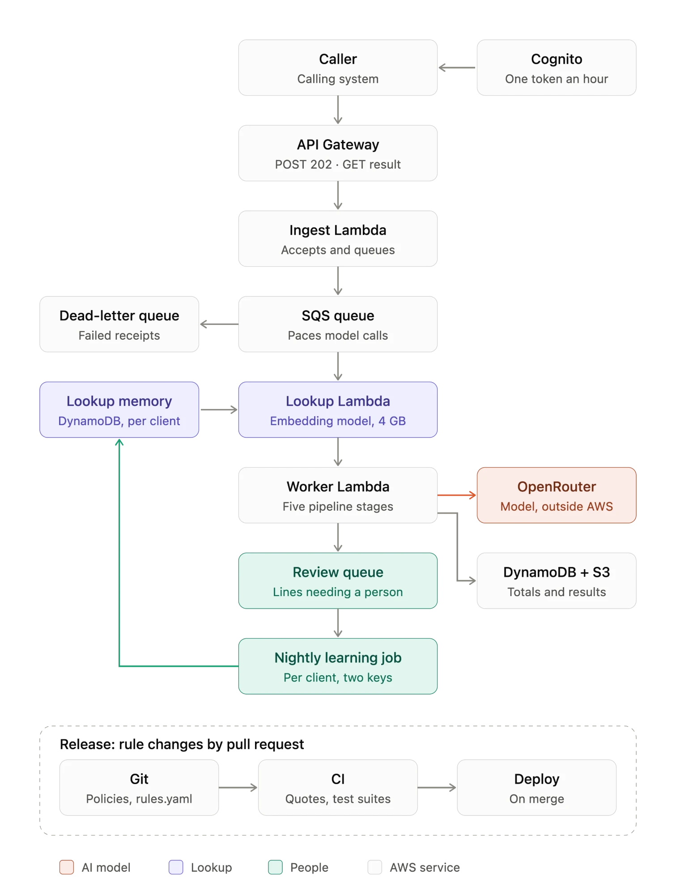

# Running the validator on AWS (on paper)

**Architecture:** caller → API Gateway → ingest Lambda → SQS → lookup Lambda → worker Lambda (the five pipeline stages) → DynamoDB and S3.
- **API: API Gateway HTTP API** (cheaper than REST APIs, with a built-in JWT authorizer): `POST /receipts` returns `202` and an ID, `GET /receipts/{id}` the result.
- **Compute: Lambdas with SQS between them**, so callers never wait on the model and concurrency stays under its rate limit; failures go to a dead-letter queue. The lookup is its own 4 GB container Lambda, so the worker isn't billed at 4 GB while it waits; its memory, one DynamoDB table shared by every client, fills nightly from reviews (two keys).
- **State and logs:** DynamoDB keeps cross-receipt totals (written once per receipt ID, so redeliveries don't count twice), S3 the results, CloudWatch Logs one trace per receipt without line text.

**Policy documents.** Policies and `rules/rules.yaml` live in git; a change is a reviewed pull request editing both. CI checks each quote and reruns the test suites; the merge deploys. Each decision records its policy, model and prompt versions. An admin screen for finance, the industry norm, would write to the same file and pass the same checks.

**Authentication and secrets.** Callers use Cognito client-credentials tokens, reused for an hour since Cognito bills per token. The OpenRouter key sits in Secrets Manager, readable only by the worker, never in code or logs.

**Cost at 50,000 receipts a day:** 50,000 × 30.4 = 1.52M receipts a month, at the final run's measured tokens.

| Line | Arithmetic | $/month |
|---|---|---|
| Model (OpenRouter, Fireworks) | 0 cached + 1050 uncached + 152 output tokens: $0.000182 per receipt × 1.52M | ≈ 277 |
| Lookup Lambda | 1.52M × 0.3 s × 4 GB × $0.0000166667 | ≈ 30 |
| Worker Lambda | 1.52M × 1.4 s (measured) × 0.5 GB × $0.0000166667 | ≈ 18 |
| API, SQS, DynamoDB, S3, logs | 3M requests, 4.5M messages, 1.52M PUTs, 3 GB of logs | ≈ 19 |
| Cognito tokens | 10 callers × 720 tokens (one an hour) × $0.00225 | ≈ 16 |

**About $360 a month**, 77% of it the model. The lookup adds $30 while its memory is cold, and pays for itself once one receipt in ten is decided whole (23 in 100 on CORD).

**Before production.**
1. **Watch the model:** alarm on errors and latency; log reviewer verdicts for flag precision.
2. **Fail safe:** retry with backoff; an unclassifiable receipt goes to **review, never pass**.
3. **Protect personal data:** agree retention terms or move to Bedrock before real receipts reach an outside API; encrypt with KMS.
